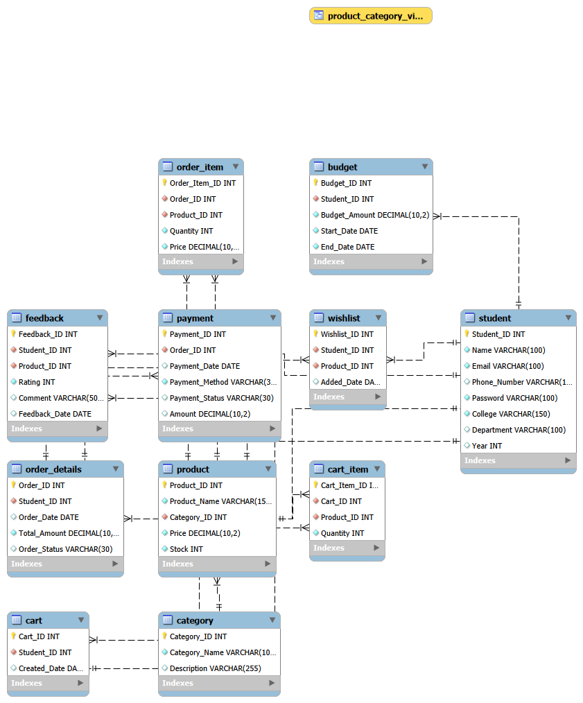

# Student Budget Online Shopping System

## Project Overview

The Student Budget Online Shopping System is a Database Management System designed to organize student information, budgets, products, shopping activities, orders, payments, wishlists and feedback in a structured relational database.

The system maintains related records using Primary Keys and Foreign Keys and supports efficient management of student budget and shopping information.

## Problem Statement

Students often face difficulty in managing limited budgets while purchasing essential items.

When prices, quantities and purchase records are tracked manually, it becomes difficult to monitor total expenditure, compare planned and actual spending, and maintain accurate records.

Therefore, a centralized relational database is developed to organize student, budget, product, cart, order, payment, wishlist and feedback information.

## Objectives

- Maintain structured student and budget information.
- Manage products and product categories.
- Connect related records using Primary Keys and Foreign Keys.
- Manage carts, orders and order items.
- Maintain payment information.
- Support wishlist and product feedback management.
- Maintain accurate and consistent data using constraints.
- Demonstrate DBMS concepts through SQL operations.

## Entities

The system contains 11 main entities:

1. Student
2. Category
3. Product
4. Budget
5. Cart
6. Cart Item
7. Order Details
8. Order Item
9. Payment
10. Wishlist
11. Feedback

## Database Technologies

- Database: MySQL
- Database Management Tool: MySQL Workbench
- Query Language: SQL
- Version Control: GitHub
- Development Environment: Visual Studio Code

## Database Operations

The project demonstrates:

- DDL – CREATE, ALTER
- DML – INSERT, UPDATE, DELETE
- DQL – SELECT
- CRUD Operations
- JOIN Operations
- Aggregate Functions
- GROUP BY
- HAVING
- Subqueries
- Views
- Primary Key constraints
- Foreign Key constraints
- NOT NULL constraints
- UNIQUE constraints
- CHECK constraints
- DEFAULT values

## Database Structure

```text
Student
   |
   ├── Budget
   ├── Cart
   ├── Order Details
   ├── Wishlist
   └── Feedback

Category
   |
   └── Product
          |
          ├── Cart Item
          ├── Order Item
          ├── Wishlist
          └── Feedback

Order Details
   |
   ├── Order Item
   └── Payment
```

## Entity Relationship Diagram



## How the Database Was Built

1. **Identify the data** needed for the shopping workflow: students, budgets, products, carts, orders, payments, wishlists and feedback.
2. **Create a relational schema** by placing each kind of information in its own table and connecting related tables with primary and foreign keys.
3. **Define integrity rules** in `ddl.sql`, including required fields, unique email and category names, valid prices and quantities, and feedback ratings from 1 to 5.
4. **Load sample records** in `dml.sql`. Parent records such as students and categories are inserted before records that reference them.
5. **Demonstrate database operations** in `queries.sql`, including CRUD examples, joins, aggregates, grouping, subqueries and a product/category view.

## Table Relationships

- One student can have multiple budgets, carts, orders, wishlist entries and feedback records.
- One category can contain multiple products.
- A cart can contain multiple cart items; each cart item refers to one product.
- An order can contain multiple order items; each order item refers to one product.
- Each payment refers to one order. `Payment.Order_ID` is unique, so an order can have at most one payment record.
- A student can wishlist many products. The unique pair of `Student_ID` and `Product_ID` prevents the same product being added twice by one student.
- Feedback connects a student to a product and constrains the rating to the range 1 through 5.

## Run the Project

Requirements: a running MySQL server and MySQL Workbench (or another MySQL client).

1. Open `ddl.sql` in the SQL client and execute it to create and select the `student_budget_shopping` database and its tables.
2. Open `dml.sql` and execute it to insert the sample students, categories, products and related records.
3. Open `queries.sql` and execute individual sections to explore the examples and results.

Run the scripts in that order. `queries.sql` includes `INSERT`, `UPDATE` and `DELETE` examples, and creates a view; it changes the database and is intended as a demonstration, not a read-only report. On the supplied seed data, run it once in a fresh database. Re-running it can add another sample product, while the view may already exist.

## Files

- `ddl.sql` creates the database tables and their constraints.
- `dml.sql` inserts the sample data used by the project.
- `queries.sql` contains CRUD, join, aggregate, subquery and view examples.
- `diagrams/erbudget.png` shows the entity relationship diagram.
- `screenshots/` contains example outputs captured in MySQL Workbench.